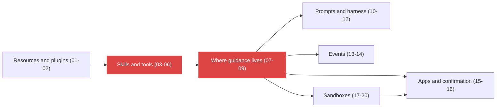

# Week 2, Lecture 3: MCP, resources and skills

> What an MCP server can expose besides tools (resources, skills, instructions, events, apps), how skills and tools map to each other, where guidance lives, and how sandboxes and confirmations keep it safe.

Source: the S02E03 written lesson and the audio transcript, checked against specs and vendor docs on 2026-11-23 to 2026-11-25. Pictures are in `img/`. Related: [Week 2, Lecture 2: Building an agent](../Week2_Lecture_2_Building_an_Agent/README.md) · [Week 2, Lecture 1: Agent primitives](../Week2_Lecture_1_Agent_Primitives/README.md) · [root README](../README.md)

## What this lecture covered

## Notes

### Resources and plugins

| File | Name | What it covers | Keywords |
|---|---|---|---|
| [01_MCP_Resources_Static_Context_And_Sampling.md](01_MCP_Resources_Static_Context_And_Sampling.md) | MCP resources and sampling | Resources are application-controlled context by URI that hosts read unevenly, and sampling lets the server borrow the host's model | resource, application-controlled, resource template, sampling |
| [02_MCP_Resources_Plugins.md](02_MCP_Resources_Plugins.md) | Plugins are host bundles | A plugin is a host's install bundle of an MCP server with skills, hooks and files, not an MCP concept | host plugin, mcp extension, registry entry, manifest, marketplace |

### Skills and tools

| File | Name | What it covers | Keywords |
|---|---|---|---|
| [03_MCP_Skills_And_Tools.md](03_MCP_Skills_And_Tools.md) | MCP skills and tools | A tool is a capability and a skill is how to use it well; the Skills extension serves both and links them only by convention | tool, skill, link, skills extension, pilot |
| [04_Router_Skill_Across_MCP_Server_Skills_And_Harness.md](04_Router_Skill_Across_MCP_Server_Skills_And_Harness.md) | Router skill across MCP layers | A router skill names which other skill to load and pays only when the catalog is the problem | router skill, catalog, hop, nested skill, fresh consent |
| [05_HATEOAS_In_MCP_Tool_Results_Spotify_Example.md](05_HATEOAS_In_MCP_Tool_Results_Spotify_Example.md) | HATEOAS in MCP tool results | A tool result that says what can be done next acts as hypermedia for agents, shown in the Spotify example | hateoas, affordance, hint, escape hatch |
| [06_Search_Over_Skills_Instead_Of_Listing_Them.md](06_Search_Over_Skills_Instead_Of_Listing_Them.md) | Search over skills | Tool search applied to skills fits past the catalog budget, and no vendor ships it yet | catalog listing, skill search, deferred loading, descriptor |

### Where guidance lives

| File | Name | What it covers | Keywords |
|---|---|---|---|
| [07_MCP_Resource_Policy_Text_From_The_Check_Rules.md](07_MCP_Resource_Policy_Text_From_The_Check_Rules.md) | Policy text from the check rules | A policy resource generated from the same stored rules as the eligibility check keeps the explanation from drifting | rule source, eligibility check, policy resource, drift |
| [08_MCP_Server_Instructions_And_Harness_Support.md](08_MCP_Server_Instructions_And_Harness_Support.md) | Server instructions and harness support | Server instructions are an optional field a client may put in the system prompt, so I keep them short | server instructions, initialize result, system prompt |
| [09_MCP_Tools_Loading_And_Code_Mode_With_Many_Servers.md](09_MCP_Tools_Loading_And_Code_Mode_With_Many_Servers.md) | Tool loading and code mode | MCP has no lazy loading of its own, so with many servers the host defers definitions and uses meta-tools | enabled, loaded, deferred loading, meta-tools, code mode |

### Prompts and harness

| File | Name | What it covers | Keywords |
|---|---|---|---|
| [10_Sys_Prompt_vs_Skills_Content_And_Threats.md](10_Sys_Prompt_vs_Skills_Content_And_Threats.md) | System prompt vs skills and threats | The instruction hierarchy is trained behavior, not a mechanism, so a contradicting skill or tool description is a risk | chain of command, tool poisoning, rug pull, precedence |
| [11_How_To_Adjust_System_Prompt_And_Make_It_Flexible.md](11_How_To_Adjust_System_Prompt_And_Make_It_Flexible.md) | Adjusting the system prompt | A prompt review is mostly relocation: each instruction moves to the cheapest place that still does its job | relocation, destination, pointer, compensation line |
| [12_Self_Evolution_Of_Harness_On_Event.md](12_Self_Evolution_Of_Harness_On_Event.md) | Self-evolution of the harness | Every harness and skill rule is a bet about model limits, so a model change triggers a review with evals | periodic review, load-bearing, ablation, regression eval |

### Events

| File | Name | What it covers | Keywords |
|---|---|---|---|
| [13_MCP_Events_And_Lifecycle_Hooks.md](13_MCP_Events_And_Lifecycle_Hooks.md) | MCP events and lifecycle hooks | MCP Events lets a server push upstream occurrences to an agent by poll, stream or webhook, and hooks can be organized around it | event, subscription, cursor, channel, hook |
| [14_MCP_Events_In_Real_Systems.md](14_MCP_Events_In_Real_Systems.md) | MCP events in real systems | Event-driven agents ship without MCP Events, so its value is a standard way to discover and subscribe | event-driven agents, webhooks, duplicates, ordering |

### Apps and confirmation

| File | Name | What it covers | Keywords |
|---|---|---|---|
| [15_MCP_Apps_And_The_Lecturers_Preview_Tool.md](15_MCP_Apps_And_The_Lecturers_Preview_Tool.md) | MCP Apps and the preview tool | "Preview" is the lecturer's tool name, and the feature is an MCP App, a tool linked to a ui:// HTML resource | mcp app, view, app-only tool, elicitation |
| [16_Human_Confirmation_Across_AG-UI_A2A_And_MCP_Channels.md](16_Human_Confirmation_Across_AG-UI_A2A_And_MCP_Channels.md) | Human confirmation across channels | A confirmation is a server-held fact that every channel only fills in, one pending record across AG-UI, A2A and MCP | pending record, channel, interrupt, elicitation |

### Sandboxes

| File | Name | What it covers | Keywords |
|---|---|---|---|
| [17_Workspaces_And_Code_Sandboxes_In_Frameworks.md](17_Workspaces_And_Code_Sandboxes_In_Frameworks.md) | Workspaces and code sandboxes | A workspace is a framework's bundle of files, sandbox and skills, and the real wall comes from a provider | workspace, sandbox, provider, backend |
| [18_Where_The_Sandbox_Attaches_Tool_Node_Backend_Or_Run_Config.md](18_Where_The_Sandbox_Attaches_Tool_Node_Backend_Or_Run_Config.md) | Where the sandbox attaches | The sandbox attaches in four places across frameworks: a tool, a backend behind the tools, an executor or run configuration | attachment point, tool, node, backend, executor |
| [19_ReAct_Vs_Deep_Agent_On_LangGraph.md](19_ReAct_Vs_Deep_Agent_On_LangGraph.md) | ReAct vs Deep Agent | A Deep Agent is the same ReAct loop with middleware around it, and the differences come from the harness | react, deep agent, middleware, todo list |
| [20_Sandbox_Against_Jailbreak_And_Prompt_Injection_Per_Tenant.md](20_Sandbox_Against_Jailbreak_And_Prompt_Injection_Per_Tenant.md) | Sandbox against injection, per tenant | No sandbox can promise injection fails, so the guarantee is a tenant boundary that limits the blast radius | blast radius, tool bridge, egress, lethal trifecta |

## Related review reminders

All reminders for this episode, in note order. The index by episode is [notes_for_later_use/README.md](../notes_for_later_use/README.md).

| File | Name | What to review | Keywords |
|---|---|---|---|
| [2026-11-23-where-my-tool-guidance-lives-s02e03-note-01.md](../notes_for_later_use/2026-11-23-where-my-tool-guidance-lives-s02e03-note-01.md) | Where my tools' guidance lives | Long tool guidance can sit in a description, server instructions, a resource or a tool result; hosts read resources unevenly | tool description, server instructions, resource |
| [2026-11-25-revisit-mcp-sampling-s02e03-note-01.md](../notes_for_later_use/2026-11-25-revisit-mcp-sampling-s02e03-note-01.md) | Revisit MCP sampling | Sampling lets a server get a completion from the host's model; the 2026-07-28 spec deprecates it | sampling, host model, deprecated |
| [2026-11-23-mcp-resources-plugins-policy-checklist-s02e03-notes-01-02-07.md](../notes_for_later_use/2026-11-23-mcp-resources-plugins-policy-checklist-s02e03-notes-01-02-07.md) | Resources, plugins, policy: what is open | Review what is checked and what is still open in notes 01, 02 and 07 | resources, plugins, policy text, open points |
| [2026-11-23-which-plugin-format-to-target-s02e03-note-02.md](../notes_for_later_use/2026-11-23-which-plugin-format-to-target-s02e03-note-02.md) | Which plugin format to target | Each host names the manifest and server file differently; decide which format to ship | plugin format, manifest, skills, hosts |
| [2026-11-23-lecturer-examples-tool-skill-links-rule-with-reason-s02e03-notes-02-07.md](../notes_for_later_use/2026-11-23-lecturer-examples-tool-skill-links-rule-with-reason-s02e03-notes-02-07.md) | Lecturer's tool-skill-links examples | Review two example repos: tool and skill links, and a rule with its reason | tool-skill-links, rule with reason |
| [2026-11-25-mcp-skills-and-tools-s02e03-note-03.md](../notes_for_later_use/2026-11-25-mcp-skills-and-tools-s02e03-note-03.md) | Review MCP skills and tools mapping | Decide how to map skills and tools and whether to pilot the Skills extension | skills extension, mapping, pilot |
| [2026-11-25-hateoas-in-mcp-tool-results-s02e03-note-05.md](../notes_for_later_use/2026-11-25-hateoas-in-mcp-tool-results-s02e03-note-05.md) | HATEOAS in tool results | The Spotify MCP example returns an answer plus how to continue, read as HATEOAS | hateoas, next moves, cursor, spotify |
| [2026-11-23-policy-text-from-my-own-rules-s02e03-note-07.md](../notes_for_later_use/2026-11-23-policy-text-from-my-own-rules-s02e03-note-07.md) | Policy text from my own rules | See whether my agent has rules that could give both the check and the explanation from one source | policy resource, single source, drift |
| [2026-11-25-mcp-server-instructions-s02e03-note-08.md](../notes_for_later_use/2026-11-25-mcp-server-instructions-s02e03-note-08.md) | MCP server instructions | Set the instructions field and check where it arrives, since most harnesses ignore or trim it | instructions, system prompt, harness support |
| [2026-11-25-review-prompts-and-skills-after-gpt-6-luna-s02e03-note-11.md](../notes_for_later_use/2026-11-25-review-prompts-and-skills-after-gpt-6-luna-s02e03-note-11.md) | Review prompts and skills after GPT-6-luna | After the model move, review verbose skills against the three prompt pieces | prompts, skills, gpt-6-luna |
| [2026-11-25-mcp-events-and-hooks-s02e03-note-13.md](../notes_for_later_use/2026-11-25-mcp-events-and-hooks-s02e03-note-13.md) | MCP as an event source, with hooks | The MCP Events extension (draft, SEP-3415) as a source of pushed events and hooks organized around it | mcp events, sep-3415, hooks |
| [2026-11-23-my-cards-as-mcp-app-for-third-party-clients-s02e03-note-15.md](../notes_for_later_use/2026-11-23-my-cards-as-mcp-app-for-third-party-clients-s02e03-note-15.md) | My cards as an MCP App | Consider shipping my UI cards as an MCP App (ui:// resource) for third-party clients | mcp app, ui resource, cards |
| [2026-11-24-human-confirmation-across-channels-s02e03-note-16.md](../notes_for_later_use/2026-11-24-human-confirmation-across-channels-s02e03-note-16.md) | One pending record for confirmations | A server-held pending record that any channel (AG-UI, A2A, MCP hosts) can resolve | pending record, hitl, channels |
| [2026-11-23-review-sandbox-against-jailbreak-per-tenant-s02e03-note-20.md](../notes_for_later_use/2026-11-23-review-sandbox-against-jailbreak-per-tenant-s02e03-note-20.md) | Review sandbox against jailbreak | Review the ten rules and the wall choice so no tenant's data reaches another in code mode | sandbox, jailbreak, per-tenant |

