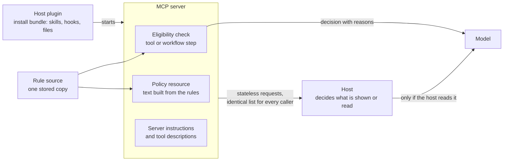

# MCP resources, plugins and policy text: what is checked, what is still open

Date: 2026-11-23, first list at 23:01 CET, checks run later the same evening
Topic: the first three Week 2 Lecture 3 notes (resources, plugins, policy text built from the check rules), and what is still open after the checks
Lecture: S02E03 Agentic Capabilities, parts "Model Context Protocol" (resources) and the transcript passages on resources and eligibility checks

I want to come back to these three notes with a clear list. This file says which questions the notes touch, what the checks found, and what remains.

## What the three notes are about

| Problem | Where the diagram shows it | Note |
|---|---|---|
| P1: Does the model ever read a resource, or only the user | Host to model, "only if the host reads it" | 01 |
| P2: Does a resource fit a stateless server | The arrow from the server to the host | 01 |
| P3: What a plugin is, and what it packs next to the tools | The plugin box | 02 |
| P4: Where long guidance lives when descriptions are short | Server instructions and the resource | 01, 02 |
| P5: The explanation drifts from the rule that decides | Rule source feeding both the check and the resource | 03 |
| P6: The check decides, the resource only explains | The check's arrow to the model | 03 |

## Checked on 2026-11-23

Status: resolved, partly resolved, open.

| # | Question | Status | What I found | Where it landed |
|---|---|---|---|---|
| 1 | Does Cursor read resources today? | partly resolved | Changelog 1.6 (2025-09-12) says support was added, and the docs table says Supported. A forum bug (2026-02-13, Cursor 2.4.31) shows Cursor sending `resources/subscribe` to a server that declared `subscribe: false`. Staff call it a known bug and suggest a no-op handler. How resources reach the model is not stated. No fix found | 01 host table, section 3 |
| 2 | Do Codex, VS Code Copilot and the OpenAI remote MCP tool expose resources to the model? | partly resolved | VS Code: the developer guide says native servers do not appear in the resource browser in Copilot sessions and to return content in a tool result. The browse commands exist only in a deprecated local harness, removed in February 2027. Codex: issue text only, no doc line. OpenAI remote MCP: silent | 01 host table, vendor guidance |
| 3 | Names of the Claude Code resource tools | resolved | `ListMcpResourcesTool` and `ReadMcpResourceTool`, no permission prompt. The list tool leaves out MCP Apps UI resources | 01 host table |
| 3a | Do resources of a plugin-bundled server show in the `@` menu | open | Not stated in the docs | 02 open question |
| 4 | Skills over MCP: Beta or Final | resolved | Both. SEP-2640 is Final (merged 2026-09-13 per the charter), and the extension stage on the overview is Beta. MCP Apps is Stable | 01, 02, Lecture 1 note 12 |
| 5 | Claude Code limit of 4,096 characters, and the 10% threshold | resolved | 4,096 characters for server instructions and upfront tool descriptions, 16,384 for descriptions loaded through tool search, `CLAUDE_CODE_MAX_MCP_DESCRIPTION_LENGTH` overrides both (v2.1.280 or later). The 10% belongs to `auto` only, and the unset default defers all MCP tools | W2L1 note 08 fixed. The limits wait for the note on packing inside one server |
| 6 | Do the Gemini CLI resource tools carry over to Antigravity CLI | open | Google's announcement (2026-05-19) says there is no 1:1 parity, and lists skills, hooks, subagents and extensions as carried over. MCP is not in that list. No resource tool documented. MCP config moved to `mcp_config.json` (secondary) | 01 host table |
| 7 | MCP Apps: status, MIME type, per-read generation | partly resolved | Stable (2026-01-26). MIME type `text/html;profile=mcp-app` is a MUST in read contents. Per-read generation is not stated. Examples read a built file, and the host may cache it | 01 |
| 8 | Cursor `mcp.json` keys, Codex plugin manifest, Agent Plugins schema | open | Not checked this round | 02 section 2 |
| 9 | Does OPA generate documentation from policies | partly resolved | Rules carry `# METADATA` annotations. `opa inspect -a` lists them. The style guide prefers them over comments so tools can parse the documentation. One example reads them in the decision message. No page calls it a generator | 03 |
| 10 | Any published source that builds prompt policy text and the check from one rule source | open | None found. The OPA annotation example is the closest | 03 |
| 11 | OPA `explain` on POST requests | open | The Context7 snippet did not cover it | 03 row 5 |
| 12 | `subscriptions/listen` and SEP-2575 wording | resolved | Spec 2026-07-28 changelog: sessions and `Mcp-Session-Id` removed (SEP-2567), `initialize` removed (SEP-2575), `server/discover` added. `subscriptions/listen` takes a filter including `resourceSubscriptions`. The first message must be `notifications/subscriptions/acknowledged` | 01 section 3 |

## Still to check

- Cursor: the related forum threads ("No MCP resources available", last activity 2026-04-21) and whether the subscribe bug is fixed.
- Codex developer docs for resources, and the `openai/codex` source for the helper tools. The docs directory in the repo has no MCP page.
- Antigravity CLI docs for a resource tool.
- Item 8, and the Agent Plugins schema.
- OPA `explain` on POST.

## To read (not read yet)

- The tail of the MCP Apps spec (read from a summary).
- SEP-2640 appendix "Deferred Features".
- The lecturer's `tool-skill-links` and `rule-with-reason` examples, since the lesson links them.
- The rest of the S02E03 lesson: personalization, MCP fundamentals, designing a custom MCP, skills with tools.

## Ideas to review later (one entry each)

- [Read the lecturer's two examples](2026-11-23-lecturer-examples-tool-skill-links-rule-with-reason-s02e03-notes-02-07.md): tool and skill links, a rule with its reason.
- [Which plugin format to target](2026-11-23-which-plugin-format-to-target-s02e03-note-02.md): one layout for several hosts, and what I give up.
- [Policy text from my own rules](2026-11-23-policy-text-from-my-own-rules-s02e03-note-07.md): one rule source for the check and the explanation.
- [Where my tools' guidance lives](2026-11-23-where-my-tool-guidance-lives-s02e03-note-01.md): description, instructions, resource or tool result.

## To try (needs my explicit yes first)

- An eval that checks per host whether the model reads a resource. It runs agents and model calls.
- A no-op `resources/subscribe` handler on my stateless server, to test the Cursor workaround.
- The `read_doc(uri)` fallback tool over the same content as a resource.
- The drift test for note 07: assert the generated policy text covers every rule id.

## Notes still to write for this lecture

- Packing tools, resources, prompts and server instructions in one MCP server, with the Claude Code limits above.
- MCP Apps and elicitation, skills over MCP, code mode numbers from the transcript, personalization and generalized instructions. The full gap list is in [CHANGELOG.md](../CHANGELOG.md).

Where the topic appears:

| Where | What it holds |
|---|---|
| [01 MCP resources](../Week2_Lecture_3_MCP_MCP+Resources_Skills/01_MCP_Resources_Static_Context_And_Sampling.md) | Ten misreadings, resource forms, stateless fit, host table |
| [02 MCP resources and plugins](../Week2_Lecture_3_MCP_MCP+Resources_Skills/02_MCP_Resources_Plugins.md) | Three meanings of "plugin", what each host plugin packs |
| [07 Policy resource from the check rules](../Week2_Lecture_3_MCP_MCP+Resources_Skills/07_MCP_Resource_Policy_Text_From_The_Check_Rules.md) | Return-policy resource, mapping to OPA, hooks, guardrails |
| [Lecture 1: 12 MCP resources and skills](../Lecture_1_Mechanics_Behind_Generative_AI/12_mcp_resources_and_skills.md) | Older, shorter note on resources and skills over MCP |
| [W2L1 08 Tool search instead of many tools](../Week2_Lecture_1_Agent_Primitives/08_Tool_Search_Instead_Of_Many_Tools.md) | Claude Code tool search and the 10% `auto` threshold |
