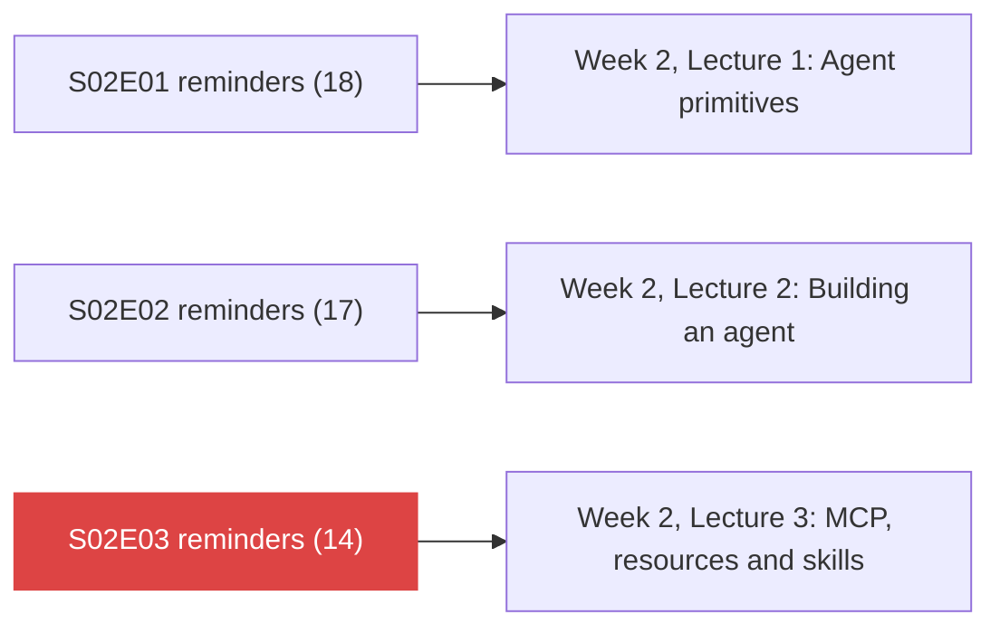

# Review reminders

> Short notes that say what I want to come back to, check or decide later. They do not fix the lecture notes. I open one on its review date, decide, then update the lecture note or delete the reminder.

File names follow `date-topic-sNNeNN-note-NN.md`: the date I wrote it, a findable topic, the episode, and the lecture note it belongs to. A reminder links to its lecture note, and each lecture README lists its reminders. Related: [root README](../README.md)

## How the reminders connect to the lectures

## S02E01: agent primitives

Lecture README: [Week 2, Lecture 1](../Week2_Lecture_1_Agent_Primitives/README.md)

| File | Name | What to review | Keywords | Note |
|---|---|---|---|---|
| [2026-11-15-recall-first-prompt-step-s02e01-note-01.md](2026-11-15-recall-first-prompt-step-s02e01-note-01.md) | Recall-first step before answering | Ask the model to recall what it knows, which methods apply and what the answer must satisfy before it acts | recall, latent space activation, prompt step | 01 |
| [2026-11-15-agent-code-sandboxing-s02e01-note-04.md](2026-11-15-agent-code-sandboxing-s02e01-note-04.md) | Sandboxing for agent-run code | Let the agent write and run Python or CLI code in a sandbox without getting out of control | sandbox, agent code, python, cli | 04 |
| [2026-11-15-agent-boundaries-s02e01-note-05.md](2026-11-15-agent-boundaries-s02e01-note-05.md) | Review the boundary structure | Review how boundaries, meaning what the agent must not do, are structured in my agents | boundaries, system prompt, must not do | 05 |
| [2026-11-15-review-compression-tools-and-prompt-s02e01-note-07.md](2026-11-15-review-compression-tools-and-prompt-s02e01-note-07.md) | Review my compression mechanism | Make sure compression never compresses tool definitions and other critical prompt pieces | compression, tool definitions, stable front, compaction | 07 |
| [2026-11-15-tool-search-instead-of-many-tools-s02e01-note-08.md](2026-11-15-tool-search-instead-of-many-tools-s02e01-note-08.md) | Tool search instead of many tools | Let the agent know its capabilities without loading every schema and decide which tools stay always available | tool search, schemas, awareness | 08 |
| [2026-11-15-manage-many-tools-gateway-s02e01-note-09.md](2026-11-15-manage-many-tools-gateway-s02e01-note-09.md) | Proxy gateway for many tools | A gateway with a disabled-by-default registry, discovery, authorization and description-change approval | gateway, registry, authorization, approval | 09 |
| [2026-11-15-memory-projects-mem0-supermemory-hindsight-s02e01-note-10.md](2026-11-15-memory-projects-mem0-supermemory-hindsight-s02e01-note-10.md) | Review Mem0, supermemory, Hindsight | Re-review the three memory projects I compared before choosing my approach | mem0, supermemory, hindsight, memory | 10 |
| [2026-11-15-memory-redisearch-bm25-review-s02e01-note-10.md](2026-11-15-memory-redisearch-bm25-review-s02e01-note-10.md) | Revisit my memory design | Compare my flat RediSearch BM25 memory with relations, placement and append-only pieces | redisearch, bm25, relations, append-only | 10 |
| [2026-11-15-audit-ledger-review-s02e01-note-12.md](2026-11-15-audit-ledger-review-s02e01-note-12.md) | Review my audit ledger | Review keeping the audit log in graph state instead of memory, and its implementation | ledger, audit log, graph state | 12 |
| [2026-11-15-memory-operations-reflect-s02e01-note-13.md](2026-11-15-memory-operations-reflect-s02e01-note-13.md) | Memory operations: reflect and maintenance | My memory has search, update and insert but no reflect; consider reflect, consolidation and maintenance loops | reflect, consolidation, maintenance, hindsight | 13 |
| [2026-11-15-review-pi-langgraph-deepseek-harnesses-s02e01-note-19.md](2026-11-15-review-pi-langgraph-deepseek-harnesses-s02e01-note-19.md) | Review Pi, LangGraph, DeepSeek harnesses | How the three harnesses differ and what each teaches about who owns the loop | pi, langgraph, deepseek, loop ownership | 19 |
| [2026-11-15-loop-hooks-next-goal-s02e01-note-20.md](2026-11-15-loop-hooks-next-goal-s02e01-note-20.md) | Hooks as my next goal | Which hook points to expose in my harness, what each may do, and fail-open or fail-closed | hooks, loop, fail-open, fail-closed | 20 |
| [2026-11-15-ai-sdk-replace-adapters-s02e01-note-21.md](2026-11-15-ai-sdk-replace-adapters-s02e01-note-21.md) | Replace my adapters with the AI SDK | Consolidate two adapters and two official SDKs into one layer, after a parity check | ai sdk, adapters, official sdks, parity check | 21 |
| [2026-11-15-a2a-peer-context-and-cancel-s02e01-note-22.md](2026-11-15-a2a-peer-context-and-cancel-s02e01-note-22.md) | What an orchestrator passes to an A2A peer | Decide between a decision summary and the full trace for a disposable peer, and handle task cancel | a2a, peer, decision summary, task cancel | 22 |
| [2026-11-15-self-configuration-s02e01-note-23.md](2026-11-15-self-configuration-s02e01-note-23.md) | Self-configuration of my harness | An agent that changes its own settings, tools and UI at runtime, and the guard around it | self-configuration, settings, runtime, guard | 23 |
| [2026-11-15-self-evolving-software-everything-is-a-plugin-s02e01-note-23.md](2026-11-15-self-evolving-software-everything-is-a-plugin-s02e01-note-23.md) | Self-evolving software, everything a plugin | Software that changes its own components at runtime and the everything-is-a-plugin architecture | self-evolving, plugin, opencode | 23 |
| [2026-11-15-pass-results-by-reference-s02e01-note-25.md](2026-11-15-pass-results-by-reference-s02e01-note-25.md) | Pass results by reference | Use a reference to a stored result instead of copying content into context | reference, memory segment, big results | 25 |
| [2026-11-15-tool-execution-instead-of-tool-calls-s02e01-note-25.md](2026-11-15-tool-execution-instead-of-tool-calls-s02e01-note-25.md) | Run tools from a script | Replace one call per tool with running the tool chain as code | code mode, tool chain, script | 25 |

## S02E02: building an agent

Lecture README: [Week 2, Lecture 2](../Week2_Lecture_2_Building_an_Agent/README.md)

| File | Name | What to review | Keywords | Note |
|---|---|---|---|---|
| [2026-11-22-cache-hit-target-95-99-s02e02-note-09.md](2026-11-22-cache-hit-target-95-99-s02e02-note-09.md) | Raise cache hit rate to 95-99% | My agent has a 75-89% hit rate; review whether 95-99% improves P90 and cost | cache hit rate, p90, cost | 09 |
| [2026-11-22-measure-latency-before-optimizing-s02e02-note-09.md](2026-11-22-measure-latency-before-optimizing-s02e02-note-09.md) | Measure latency before optimizing | Measure TTFT, token speed and the step waterfall first | ttft, token speed, step waterfall | 09 |
| [2026-11-22-cache-and-context-window-s02e02-note-10.md](2026-11-22-cache-and-context-window-s02e02-note-10.md) | Cache and context window stack | How the system prompt, tools, developer messages and a mid-turn message are laid out so the cache survives | context stack, cache, developer messages | 10 |
| [2026-11-22-model-routing-several-models-s02e02-note-11.md](2026-11-22-model-routing-several-models-s02e02-note-11.md) | Several models in one execution | Check my suspicions about model routing and several models in one LangGraph run | model routing, several models, langgraph | 11 |
| [2026-11-22-agent-freedom-needs-proof-of-control-s02e02-note-12.md](2026-11-22-agent-freedom-needs-proof-of-control-s02e02-note-12.md) | Agent freedom needs proof of control | Smarter models allow more freedom, so I need more proof that control stays mine | freedom, proof of control, filters | 12 |
| [2026-11-22-llm-adapters-and-gateway-review-s02e02-note-13.md](2026-11-22-llm-adapters-and-gateway-review-s02e02-note-13.md) | Provider approach: adapters and gateway | Review whether Azure AI Foundry and Anthropic support should become pure adapters with a gateway in front | adapters, gateway, azure foundry | 13 |
| [2026-11-22-execution-flows-skill-growth-s02e02-note-14.md](2026-11-22-execution-flows-skill-growth-s02e02-note-14.md) | Execution flows and skill growth | Load the skill that explains how to act, then do the job; review what happens as the skill grows | execution flow, skill, one skill per conversation | 14 |
| [2026-11-22-tool-navigation-odata-pydantic-s02e02-note-15.md](2026-11-22-tool-navigation-odata-pydantic-s02e02-note-15.md) | Tool errors and my setup | Compare my OData contract, MCP-side validation and Pydantic annotations with how others keep tool error rates low | tool errors, odata, pydantic, validation | 15 |
| [2026-11-22-memory-centric-events-ledger-journal-s02e02-note-16.md](2026-11-22-memory-centric-events-ledger-journal-s02e02-note-16.md) | Memory-centric agent: Ledger or Journal | Memory changes arrive through channels and an event; I register messages, a journal and a schedule | events, ledger, journal, schedule | 16 |
| [2026-11-22-automated-pentest-of-my-agent-s02e02-note-17.md](2026-11-22-automated-pentest-of-my-agent-s02e02-note-17.md) | Penetration test my agent automatically | Find issues such as the agent reading data from sources that do not belong to it | pentest, content safety, guardrails | 17 |
| [2026-11-22-framework-review-beyond-langgraph-s02e02-note-18.md](2026-11-22-framework-review-beyond-langgraph-s02e02-note-18.md) | Is there a better framework than LangGraph | Check modern frameworks for the needed primitives and flexibility | langgraph, frameworks, primitives | 18 |
| [2026-11-22-evict-tool-results-to-memory-references-s02e02-note-19.md](2026-11-22-evict-tool-results-to-memory-references-s02e02-note-19.md) | Evict tool results, keep references | Instead of summarizing at 75%, evict old results to my own Runtime and Redis store and keep references | eviction, references, redis | 19 |
| [2026-11-22-engagement-signals-proactive-agent-s02e02-note-21.md](2026-11-22-engagement-signals-proactive-agent-s02e02-note-21.md) | Steering the agent with activity events | The agent reads events about my activity and adjusts or stops actions | activity events, engagement, proactive agent | 21 |
| [2026-11-22-long-horizon-concurrency-durability-s02e02-note-22.md](2026-11-22-long-horizon-concurrency-durability-s02e02-note-22.md) | Long-horizon runs: concurrency and durability | Parallel updates that may lose data, queues or versioning, pi-durable and pi-until against the industry | parallel updates, versioning, pi-durable | 22 |
| [2026-11-22-wake-and-reflect-on-the-market-s02e02-note-23.md](2026-11-22-wake-and-reflect-on-the-market-s02e02-note-23.md) | Wake and reflection against the market | An agent wakes on its own schedule, logs a journal, writes insights and reflects before the next wake-up | wake, reflection, journal, insights | 23 |
| [2026-11-22-pi-durable-review-s02e02-note-24.md](2026-11-22-pi-durable-review-s02e02-note-24.md) | pi-durable review | Review how pi-durable supports long-running tasks that recover after failures and can pause | pi-durable, recovery, pause | 24 |
| [2026-11-22-always-on-agents-leerob-s02e02-note-25.md](2026-11-22-always-on-agents-leerob-s02e02-note-25.md) | Always-on agents talk to reread | Read again the talk on agents that sleep, wake on an event, load state, work and sleep | always-on, sleep, wake, state | 25 |

## S02E03: MCP, resources and skills

Lecture README: [Week 2, Lecture 3](../Week2_Lecture_3_MCP_MCP+Resources_Skills/README.md)

| File | Name | What to review | Keywords | Note |
|---|---|---|---|---|
| [2026-11-23-where-my-tool-guidance-lives-s02e03-note-01.md](2026-11-23-where-my-tool-guidance-lives-s02e03-note-01.md) | Where my tools' guidance lives | Long tool guidance can sit in a description, server instructions, a resource or a tool result; hosts read resources unevenly | tool description, server instructions, resource | 01 |
| [2026-11-25-revisit-mcp-sampling-s02e03-note-01.md](2026-11-25-revisit-mcp-sampling-s02e03-note-01.md) | Revisit MCP sampling | Sampling lets a server get a completion from the host's model; the 2026-07-28 spec deprecates it | sampling, host model, deprecated | 01 |
| [2026-11-23-mcp-resources-plugins-policy-checklist-s02e03-notes-01-02-07.md](2026-11-23-mcp-resources-plugins-policy-checklist-s02e03-notes-01-02-07.md) | Resources, plugins, policy: what is open | Review what is checked and what is still open in notes 01, 02 and 07 | resources, plugins, policy text, open points | 01, 02, 07 |
| [2026-11-23-which-plugin-format-to-target-s02e03-note-02.md](2026-11-23-which-plugin-format-to-target-s02e03-note-02.md) | Which plugin format to target | Each host names the manifest and server file differently; decide which format to ship | plugin format, manifest, skills, hosts | 02 |
| [2026-11-23-lecturer-examples-tool-skill-links-rule-with-reason-s02e03-notes-02-07.md](2026-11-23-lecturer-examples-tool-skill-links-rule-with-reason-s02e03-notes-02-07.md) | Lecturer's tool-skill-links examples | Review two example repos: tool and skill links, and a rule with its reason | tool-skill-links, rule with reason | 02, 07 |
| [2026-11-25-mcp-skills-and-tools-s02e03-note-03.md](2026-11-25-mcp-skills-and-tools-s02e03-note-03.md) | Review MCP skills and tools mapping | Decide how to map skills and tools and whether to pilot the Skills extension | skills extension, mapping, pilot | 03 |
| [2026-11-25-hateoas-in-mcp-tool-results-s02e03-note-05.md](2026-11-25-hateoas-in-mcp-tool-results-s02e03-note-05.md) | HATEOAS in tool results | The Spotify MCP example returns an answer plus how to continue, read as HATEOAS | hateoas, next moves, cursor, spotify | 05 |
| [2026-11-23-policy-text-from-my-own-rules-s02e03-note-07.md](2026-11-23-policy-text-from-my-own-rules-s02e03-note-07.md) | Policy text from my own rules | See whether my agent has rules that could give both the check and the explanation from one source | policy resource, single source, drift | 07 |
| [2026-11-25-mcp-server-instructions-s02e03-note-08.md](2026-11-25-mcp-server-instructions-s02e03-note-08.md) | MCP server instructions | Set the instructions field and check where it arrives, since most harnesses ignore or trim it | instructions, system prompt, harness support | 08 |
| [2026-11-25-review-prompts-and-skills-after-gpt-6-luna-s02e03-note-11.md](2026-11-25-review-prompts-and-skills-after-gpt-6-luna-s02e03-note-11.md) | Review prompts and skills after GPT-6-luna | After the model move, review verbose skills against the three prompt pieces | prompts, skills, gpt-6-luna | 11 |
| [2026-11-25-mcp-events-and-hooks-s02e03-note-13.md](2026-11-25-mcp-events-and-hooks-s02e03-note-13.md) | MCP as an event source, with hooks | The MCP Events extension (draft, SEP-3415) as a source of pushed events and hooks organized around it | mcp events, sep-3415, hooks | 13 |
| [2026-11-23-my-cards-as-mcp-app-for-third-party-clients-s02e03-note-15.md](2026-11-23-my-cards-as-mcp-app-for-third-party-clients-s02e03-note-15.md) | My cards as an MCP App | Consider shipping my UI cards as an MCP App (ui:// resource) for third-party clients | mcp app, ui resource, cards | 15 |
| [2026-11-24-human-confirmation-across-channels-s02e03-note-16.md](2026-11-24-human-confirmation-across-channels-s02e03-note-16.md) | One pending record for confirmations | A server-held pending record that any channel (AG-UI, A2A, MCP hosts) can resolve | pending record, hitl, channels | 16 |
| [2026-11-23-review-sandbox-against-jailbreak-per-tenant-s02e03-note-20.md](2026-11-23-review-sandbox-against-jailbreak-per-tenant-s02e03-note-20.md) | Review sandbox against jailbreak | Review the ten rules and the wall choice so no tenant's data reaches another in code mode | sandbox, jailbreak, per-tenant | 20 |
